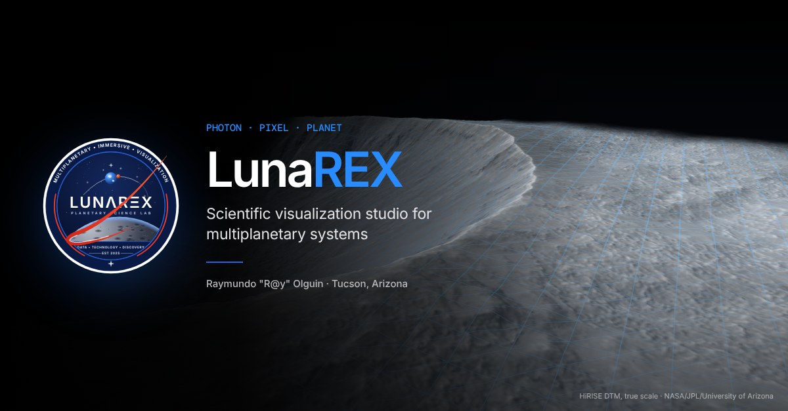

# LunaREX, a scientific visualization studio for multiplanetary systems

**Author: Raymundo "R@y" Olguin** | LunaREX | Tucson, Arizona | Est. 2025

**Photon to pixel to planet.** At the interface of electrical engineering and planetary science, LunaREX transforms calibrated stereo pairs of the Moon, Mars and Europa, through photogrammetry, into 3D digital terrain models for scientific analysis and immersive XR exploration.

This repository is the LunaREX studio website, version 3: a static site that runs entirely in the browser (HTML, CSS, JavaScript and WebGL), ready for GitHub Pages. The hosted site needs no build step, no server code and no third-party requests (the fonts are served from this repository).



---

## What the site does

| Section | What it shows |
|---|---|
| Hero | The interactive LunaREX emblem (it tilts toward the pointer or finger with a moving highlight, and spins once when pressed) and the title **LunaREX**, with the tagline "Photon to pixel to planet", over a real HiRISE DTM window (Noachis Terra craters, true scale) in WebGL. Scrolling runs the instrument chain: **Photon** (pushbroom reveal of the orthoimage), **Pixel** (elevation tint with contours at a round interval), **Mesh** (triangulation front), **Planet** (lit, from 30 m above the surface). An instrument column shows height above ground, a logarithmic altitude tape (10 m to 10 km) and the current stage. |
| 1 Studio | The LunaREX emblem, mission statement and key figures. |
| Flight | Scroll-driven spiral descent over the Cavi Angusti south polar DTM. |
| 2 Pipeline | Four-stage stepper with an animated figure per stage. Arrow keys move between stages. |
| 3 Worlds | Rotating globes of the Moon, Mars and Europa from real global mosaics, **drawn at their true relative sizes**, with mean radius, surface gravity and rotation period. |
| 4 Terrain lab | **60 real DTMs**: all 40 HiRISE DTMs produced at HiROC by Raymundo "R@y" Olguin, 10 LROC NAC DTMs of the Moon, 10 Galileo DTMs of Europa. The lab follows the story of the hero in two stages of four viewports each. **Photon**: the orthorectified image in four drawings (perspective, isometric, plan, front). **Pixel**: four parameters of the same grid (elevation, thermal model with cast shadows, slope, shaded relief; mesh on request) on linked cameras. Every legend states its method and cites the paper behind it. |
| 7 References | 91 peer-reviewed papers, grouped by topic, each cited where the page uses it, with DOI links. |
| 5 Founder | Portrait and short bio. |
| 6 Links | Portfolio, GitHub, LinkedIn and Linktree. |
| Closing flight | Crane move over the Hebes Mensa DTM. |

### Terrain lab stages

| Stage | Story step | Viewports open with | Cameras |
|---|---|---|---|
| The orthorectified image, in four drawings | Photon | 1 Perspective, 2 Isometric, 3 Plan, 4 Front, all showing the orthoimage | Independent: each viewport can be any of the four drawings |
| Four measurements from the same grid | Pixel | 1 Elevation, 2 Thermal, 3 Slope, 4 Shaded relief, all isometric | Linked: the four move together, so the maps stay registered |

World, DTM, vertical exaggeration, downsampling factor and auto-rotate are shared by both stages. Each stage has its own bar (1 view / 4 views, zoom, reset) and its own legend for the selected viewport. Each stage is one WebGL canvas drawn with scissored viewports.

### Drawings (cameras)

| Drawing | Projection | What it is for | Interaction |
|---|---|---|---|
| Perspective | Perspective, free orbit | The form as a headset shows it | Drag to orbit, zoom, auto-rotate |
| Isometric | Orthographic, 35.264 deg above the horizon (atan(1/sqrt 2)), on a diagonal | The three axes are foreshortened equally | Drag turns it and it settles on the nearest diagonal, zoom |
| Plan | Orthographic, straight down, image top up | The map: lengths are to scale | Zoom |
| Front | Orthographic, level with the ground, from the bottom edge of the image | An elevation drawing: heights and lengths are to scale | Zoom |

### Parameters (view types)

| Parameter | What is drawn | Math |
|---|---|---|
| Orthoimage | The orthorectified image on the mesh, unlit | The image already carries the real sunlight, so no second light is added |
| Elevation | Metres above the lowest post in the window | LunaREX altimetry ramp, legend in metres (see below) |
| Thermal | Modeled direct-beam radiative-equilibrium temperature in kelvin | `(1 - A) S cos(i) = eps sigma T^4`, so `T = Tmax cos(i)^(1/4)`; true-scale normals; cast shadows from the DTM; Sun from the two sliders |
| Slope | Slope in degrees, 0 to 45 | Horn (1981) 3 x 3 finite differences at the displayed post spacing (baseline of two post spacings, stated in the legend); always true scale |
| Shaded relief | Hillshade of the DTM alone | cos(incidence) for the Sun from the two sliders; uses the exaggerated surface (z-factor convention) |
| Mesh | The triangles the index buffer contains | Lines follow the real triangle diagonals |

**LunaREX altimetry.** The elevation ramp keeps the hue order of the HiRISE color altimetry products (violet and blue for low ground, then green, yellow, orange and red, white for the highest), but it is built in OKLCH with lightness rising steadily from low to high and moderate chroma. A classic rainbow gets darker again between yellow and red; this one does not, so a grayscale print still reads low to high. The same ramp tints the Pixel stage of the hero, the flights and the pipeline figure. It is `makeAltimetry` in `assets/js/dtm.js`.

**Thermal model, and what it is not.** No thermal data ships with these DTMs. The Thermal view is a physical model computed from the DTM: the direct-beam radiative equilibrium of each facet for the chosen Sun, `(1 - A) S cos(i) = eps sigma T^4`, on true-scale slopes (the slope term of Aharonson and Schorghofer, 2006), with cast shadows found by a horizon test on the DTM (as in Mazarico et al., 2011). The solar constant is the IAU 2015 nominal 1361 W/m^2 (Prsa et al., 2016; Kopp and Lean, 2011), scaled to the body's distance. It is the zero-thermal-inertia limit, so it is a ceiling on daytime temperature: real surfaces store heat, lag the Sun and peak lower (Kieffer, 2013). Facets in shadow or turned from the Sun are drawn grey, "no direct sunlight", because the model has nothing to say about them. Not modeled: thermal inertia, the atmosphere, heat and light from neighbouring terrain, sub-pixel roughness, and shadows cast by terrain outside the window.

The ceiling is checked against published measurements, and the legend shows the check:

| Body | Distance (AU) | Bond albedo A | Emissivity | Model ceiling (K) | Measured | Source of the measurement |
|---|---|---|---|---|---|---|
| Moon | 1.0 | 0.12, as in the Diviner thermal models (Vasavada et al., 2012; Hayne et al., 2017) | 0.95, same sources | 386 | 387 to 397 K equatorial daytime maximum | Williams et al. (2017) |
| Mars | 1.524 | 0.25, inside the 0.09 to 0.43 mapped by Viking (Kieffer et al., 1977) | 0.95, an assumption | 301 | up to 290 K | Kieffer et al. (1977) |
| Europa | 5.203 | 0.62, a working assumption | 0.90, a working assumption | 139 | 132 K low-latitude daytime peak | Spencer et al. (1999) |

The Europa albedo and emissivity and the Mars emissivity are not taken from a paper; the page says so. All parameters are in `BODY` in `assets/js/globes.js`.

### Terrain lab controls

| Control | Action |
|---|---|
| Click a viewport, or keys `1` to `4` | Select the viewport that the controls act on |
| 1 view / 4 views | One large viewport or the four-viewport grid, per stage |
| Sun azimuth, Sun altitude | Light for the shaded relief, the cast shadows and the thermal model |
| Drag | Orbit the selected viewport (stops auto-rotation) |
| Pinch, or Ctrl / Cmd + scroll | Zoom, without taking over page scrolling |
| `-` `+` `Reset view` buttons | Zoom the selected viewport and return it to its opening camera |
| Numbered citations | Jump to the paper in the References chapter |
| Arrows beside the terrain name, or `[` and `]` | Previous and next terrain, from either stage |
| Double tap or double click | Reset that viewport |
| Save image | PNG of the stage with viewport labels and the data credit |
| Full screen, or `F` | The stage fills the screen (not offered where the browser lacks element full screen, such as iPhone Safari) |
| Method and sources | Opens the method and citations behind the selected viewport's legend |
| Search | Filters the thumbnails by name, product or region |
| Share this terrain | System share sheet on phones, copies the link elsewhere |
| Reset settings | Defaults for every lab setting and camera; clears what was remembered |
| Keyboard, with the view focused | Arrow keys orbit, `+` and `-` zoom, `0` resets |
| True scale, 1.0x / Suggested | Jump between no exaggeration and the value suggested for that DTM |
| `?dtm=<slug>` in the address | Opens the page on that DTM, so a single terrain can be linked directly |

---

## User experience: 50 concepts for iPhone and desktop

Each concept below is applied on the page. **34 are new in version 3.4**; the other 16 were already in place and were re-checked. "iPhone" and "Desktop" name where a concept matters most; most of them help on both.

| # | Platform | Concept | How this site applies it | Status |
|---|---|---|---|---|
| 1 | iPhone | Safe areas | Bars, gutters, captions and the footer clear the notch, status bar and home indicator (`viewport-fit=cover`, `env(safe-area-inset-*)`) | New |
| 2 | iPhone | Fingertip-sized targets | Every button, tab, select and slider is at least 44 px on touch screens (`pointer:coarse`) | New |
| 3 | iPhone | No zoom on focus | Form controls are 16 px or larger, so Safari does not zoom the page when one is focused | New |
| 4 | iPhone | Controls where the thumb is | Previous and next terrain arrows sit in each viewer bar, so the terrain changes without scrolling back to the controls | New |
| 5 | iPhone | One viewport first | Phones open each stage on one large viewport; four views stay one tap away | Kept |
| 6 | iPhone | Swipeable gallery | The 60 thumbnails become one snap-scrolling row on phones, which keeps the page short | New |
| 7 | iPhone | Selection stays in view | The selected thumbnail is centred in the row whenever the terrain changes | New |
| 8 | iPhone | Scroll is never trapped | Vertical swipes over a 3D view always scroll the page; horizontal drags orbit | Kept |
| 9 | iPhone | Pinch to zoom | Two fingers zoom the selected viewport | Kept |
| 10 | iPhone | Double tap to reset | Two quick taps return a viewport to its opening camera | New |
| 11 | iPhone | Compact viewer bar | Viewer tools sit in one horizontally scrolling row instead of three stacked rows | New |
| 12 | iPhone | Shorter descent | The hero scroll is 270 % of the screen on phones instead of 340 %, and the flights 180 % | New |
| 13 | iPhone | Landscape layout | Held sideways, the type steps down and the 3D stage keeps most of the height | New |
| 14 | iPhone | Quiet touch feedback | No grey tap flash or accidental text selection on controls; double-tap zoom is off on buttons | New |
| 15 | iPhone | Toolbar follows the page | The browser toolbar tint switches between black and white with the band behind the bar | New |
| 16 | iPhone | Add to Home Screen | Web app manifest and iOS meta tags: the site opens full screen with its own icon and name | New |
| 17 | iPhone | Native share sheet | Share this terrain opens the system share sheet with a link to the current DTM | New |
| 18 | iPhone | Forgiving menu | The menu closes on a tap outside it, on Escape and after a choice; it scrolls inside itself on short screens | New |
| 19 | iPhone | Contained overscroll | The menu, the gallery row, the viewer tools and the legend do not drag the page when they reach their end | New |
| 20 | iPhone | Data when needed | The first terrain is fetched when the lab is about a screen away, so the hero loads alone | New |
| 21 | iPhone | Small-screen viewport units | Sticky scenes use small-viewport height, so Safari's moving toolbar does not crop them | Kept |
| 22 | iPhone | System text size | Type is set in rem and `text-size-adjust` is neutral, so the user's text size setting applies | Kept |
| 23 | iPhone | Thumbnail names without hover | On touch screens the terrain names are always shown on the thumbnails | Kept |
| 24 | iPhone | Reduced motion | With Reduce Motion on, auto-rotation, the scan reveal and smooth scrolling are off | Kept |
| 25 | iPhone | Shared links land in place | A link with `?dtm=<slug>` opens at the lab with that terrain loaded | New |
| 26 | Desktop | Chapter navigation | All chapters are in the bar with the current one marked; the bar takes the ground of the band behind it | Kept |
| 27 | Desktop | Viewer keyboard control | 1 to 4 select a viewport, arrows orbit, + and - zoom, 0 resets | Kept |
| 28 | Desktop | Terrain and full-screen keys | [ and ] change terrain, F toggles full screen | New |
| 29 | Desktop | Discoverable controls | A Controls panel lists every mouse, keyboard and touch action in one place | New |
| 30 | Desktop | Zoom without hijacking scroll | Ctrl or Cmd + wheel zooms; a plain wheel scrolls the page and shows a short hint on the viewer | New |
| 31 | Desktop | Hover feedback | The viewport under the pointer is outlined before it is clicked | New |
| 32 | Desktop | Full screen | Each stage can fill the screen (where the browser supports element full screen) | New |
| 33 | Desktop | Save image | Each stage exports a PNG of its viewports with labels and the data credit | New |
| 34 | Desktop | Remembered settings | Layout, Sun, downsampling factor and auto-rotate are stored on the device | New |
| 35 | Desktop | Reset settings | One button returns every lab setting and camera to its default and clears the stored values | New |
| 36 | Desktop | Search | A search field filters the terrains by name, product or region, with a clear message when nothing matches | New |
| 37 | Desktop | Recover from errors | A failed load says what failed and offers Try again in place | New |
| 38 | Desktop | Progressive disclosure | Each legend is one line; Method and sources opens the full method with its citations, and stays open while you adjust | New |
| 39 | Desktop | Skip the descent | A link during the hero scroll jumps straight to the studio | New |
| 40 | Desktop | Readable contrast | Small grey text on white is 5.4:1 (was 4.4:1), above the 4.5:1 minimum | New |
| 41 | Desktop | More contrast on request | With the system's Increase Contrast setting, rules, labels and scrims are strengthened | New |
| 42 | Desktop | Print | Printing gives the text chapters and the full reference list on white, without scenes or controls | New |
| 43 | Desktop | Fast long pages | The reference groups are laid out only when they come near the screen (`content-visibility`) | New |
| 44 | Desktop | Visible focus and skip link | Every control shows a focus ring; the first Tab stop skips to the content | Kept |
| 45 | Desktop | Measure | Running text stays under about 66 characters per line | Kept |
| 46 | Desktop | Stable numbers | Read-outs use tabular numerals, so digits do not shift while values change | Kept |
| 47 | Desktop | Citations in reach | A citation shows author and year on hover and jumps to the highlighted reference | Kept |
| 48 | Desktop | Honest loading states | While a terrain loads, the view dims and names what is loading | Kept |
| 49 | Desktop | Linked comparison | The four parameter viewports share one camera, so maps stay registered up to 1,680 px wide | Kept |
| 50 | Desktop | Work only when seen | 3D scenes render only while on screen and only when something changed | Kept |

These were checked with 39 scripted interactions in headless Chrome on three viewports: desktop (1500 x 950), an iPhone-sized touch screen (390 x 844 at 3x) and the same phone in landscape. Chrome's phone emulation is not Safari: safe areas, the share sheet, Add to Home Screen and the toolbar tint need a look on a real iPhone.

---

## What changed in version 3

**Mathematical accuracy**

- **Post registration is exact.** The 128-post lab tiles are 2 x 2 block means of the 256-post lattice, so post `k` sits at `(k + 1/4) * S / (N - 1/2)` and the spacing is `S / (N - 1/2)`, not `S / N`. This was confirmed against the 256-post tiles of the same windows (0.004 m RMS residual). Version 2 stretched every lab mesh by 0.4 % and shifted the orthoimage by a quarter post.
- **Downsampling no longer distorts the mesh.** Version 2 stretched the downsampled grid to fill the window (up to 2.4 % at factor 4) and moved the orthoimage with it. Vertices and UVs now stay on their true posts at every downsampling factor.
- **Mesh lines match the mesh.** The wireframe drew the opposite diagonal from the one the triangles use. It now follows the index buffer.
- **Slope view added**, computed from true-scale heights with Horn's method, with the median slope reported per DTM.
- **Shaded relief is a real hillshade** (Lambert, stated sun azimuth and altitude) instead of a contrast curve multiplied onto an image that already contains sunlight.
- **Color ramps rise steadily in lightness** (built in OKLab and OKLCH), and the same lookup tables feed the shaders, the legends and the pipeline figure.
- **Contours use a round 1-2-5 interval** (50 m, 100 m ...) and the caption states it.
- **Captions are computed from the tile metadata**, which fixed the Cavi Angusti window size (4.15 km, not 3.6 km).
- **The hero ends at a stated 30 m above the ground** instead of claiming eye height from 60 m.
- **Body constants**: IAU mean radii (Archinal et al., 2018), gravity derived as `g = GM / R^2`, and axial tilts on one convention (relative to each body's orbit around the Sun).
- **No-data posts** are handled the same way everywhere (left out of the mesh, ignored in statistics).

**Code**

- New `assets/js/dtm.js`: one module for decoding, registration, meshing, slope, sampling and color. The hero, the flights and the lab all use it. It has no renderer dependency and is covered by `tests/dtm.test.mjs`.
- Fixed a `ReferenceError` (`ramp` was undefined) that stopped the pipeline figure on the Pixel stage.
- Fixed a race in the lab: choosing DTMs quickly could leave an older one on screen. Stale loads are now dropped.
- Load failures show a message in the viewer instead of an endless "Loading".
- Animation loops stop when their section is off screen; auto-rotation is frame-rate independent; the globes share one render buffer.
- The stylesheet was rewritten as a single system (the earlier file layered a second theme over the first, with dead rules).

**Design and experience**

- Data sections (hero, flights, worlds, terrain lab) sit on black; studio sections sit on white. One set of components serves both.
- The headline gives way to a stage caption while you descend, so the terrain is not covered for the whole scroll.
- Full chapter navigation in the bar (with a menu on small screens); the bar takes the ground of the band behind it.
- Fonts are self-hosted (Inter variable with optical sizing, DM Mono), so the site and the single-file edition work offline.
- The terrain lab is two full-width stages of four viewports that follow the story: the image in four drawings, then four parameters. Elevation uses the LunaREX altimetry ramp (HiRISE hue order, even lightness). The thermal model has cast shadows and is checked against published measurements. A References chapter lists 91 papers, each cited in place.
- Scroll-triggered fade-ins and count-up numbers were removed; motion is reserved for the scroll descent and direct manipulation.

---

## Publish on GitHub Pages

1. Create a new **public** repository on GitHub named **`LunaREX`** (the link preview tags assume this name, see below).
2. Upload **the contents of this folder**, not the folder itself: `index.html`, `README.md`, `.nojekyll` and `assets/` must sit at the root of the repository.
   - Web upload: **Add file > Upload files**, drag everything in, then **Commit changes**. The web uploader takes up to 100 files per batch, so upload `assets/` in two or three batches if it complains.
   - Or with git:
     ```bash
     git init && git add . && git commit -m "LunaREX studio site v3"
     git branch -M main
     git remote add origin https://github.com/rayolguinm/LunaREX.git
     git push -u origin main
     ```
3. In the repository go to **Settings > Pages > Build and deployment**, choose **Deploy from a branch**, branch **`main`**, folder **`/ (root)`**, then **Save**.
4. After a minute the site is live at **https://rayolguinm.github.io/LunaREX/**.

`.nojekyll` must stay: it tells GitHub Pages to serve every file exactly as it is.

### Backup plan: returning to version 2

If version 2 is already published, tag it before pushing version 3, so one command brings it back:

```bash
git tag v2            # on the commit that holds version 2, before you add these files
git push origin v2
# later, to return to version 2:
git checkout v2 -- . && git commit -m "Return to v2" && git push
```

Without git, keep `LunaREX_v2_code_backup.zip`. It holds the version 2 `index.html`, `README.md`, `assets/css` and `assets/js`. The data in `assets/data` and `assets/img` is unchanged between versions, so unzipping the backup over this folder restores version 2. Version 3 adds `assets/fonts`, `assets/js/dtm.js`, `tests` and `tools`, which version 2 ignores.

---

## LinkedIn thumbnail (link preview)

When you paste the site link into a LinkedIn post or your profile, LinkedIn shows **`assets/img/linkedin-card.jpg`** (1200 x 627 px, LinkedIn's recommended size) with the title and description from the `og:` tags in `index.html`.

- LinkedIn needs **absolute** addresses. The tags point to `https://rayolguinm.github.io/LunaREX/`. If you name the repository differently, open `index.html` and replace that address in the `og:url`, `og:image`, `twitter:image` and `canonical` lines.
- LinkedIn caches previews. After publishing, or after changing the card, paste the site address into the **LinkedIn Post Inspector** (linkedin.com/post-inspector) and press **Inspect** to refresh it.
- The card can be replaced with any 1200 x 627 JPG of the same name.

---

## File structure

```
LunaREX/
├── index.html                 page markup, link preview tags, emblem (inline SVG)
├── README.md                  this file
├── .nojekyll                  serve files as-is on GitHub Pages
├── manifest.webmanifest       name, icon and colors for Add to Home Screen
├── assets/
│   ├── css/site.css           design system: band tokens, components, layout (NASA HDS Core colors, CC0)
│   ├── fonts/                 Inter variable (Latin, Greek) and DM Mono, woff2 (SIL Open Font License)
│   ├── js/
│   │   ├── main.js            interface: bar, hero read-outs, pipeline stepper, worlds, terrain lab, links
│   │   ├── dtm.js             DTM core: decode, registration, mesh, Horn slope, cast shadows, thermal model, color ramps
│   │   ├── terrain3d.js       hero descent and interlude flights (three.js, real DTM windows)
│   │   ├── labview.js         terrain lab viewer: four viewports, four drawings, six parameters
│   │   ├── refs.js            the reference list: 91 papers, records taken from Crossref
│   │   ├── globes.js          Moon, Mars and Europa globes, body constants
│   │   └── assets.js          asset path resolver (used by the single-file edition)
│   ├── three/                 three.js (MIT license, see LICENSE.txt)
│   ├── img/                   LinkedIn card, favicons, founder portrait, globe textures
│   └── data/
│       ├── lab/
│       │   ├── catalog.json   60 DTM records: window, post spacing, relief, source, credit, orthoimage
│       │   ├── mars/          40 HiRISE windows: <slug>.png (heights) + <slug>.jpg (orthoimage)
│       │   ├── moon/          10 LROC NAC windows + thumbnails (<slug>_t.jpg)
│       │   └── europa/        10 Galileo windows + thumbnails
│       ├── thumbs/            40 HiRISE orthoimage thumbnails for the picker
│       └── <dtm-slug>/        hero and flight windows: height.png, texture.jpg, meta.json
├── tests/dtm.test.mjs         numeric checks for dtm.js
└── tools/build-single.mjs     builds the single-file edition
```

### Data format

**Height tiles** are lossless 16-bit terrain-RGB PNGs: `elevation_m = (256 * R + G) * z_scale_m` above the window minimum, and `65535` means no data. Two layouts exist:

| Tiles | Posts | Layout | Position of post `k` in a window of side `S` |
|---|---|---|---|
| Hero and flights (`assets/data/<slug>/height.png`) | 256 x 256 | `edge` | `k * S / 255` |
| Terrain lab (`assets/data/lab/<world>/<slug>.png`) | 128 x 128 | `block` (2 x 2 means of the edge lattice) | `(k + 1/4) * S / 127.5` |

`catalog.json` lists `post_m = window / 128`. The viewer derives the exact spacing (`window / 127.5`) from `window_km`, so the catalog does not need editing. Every window keeps true scale; vertical exaggeration is applied in the viewer only.

---

## Checks and build

**Numeric checks** (Node 22 or newer, no packages needed):

```bash
node tests/dtm.test.mjs
```

Thirteen checks cover post registration for both layouts, mesh positions and UVs at every downsampling factor, no-data handling, Horn slope against analytic planes, bilinear sampling, statistics, contour intervals, the lightness and hue order of the color ramps, cast shadow length against height / tan(altitude), and the thermal model.

**Single-file edition** (`LunaREX.html`, runs by double-click, no server, no network):

```bash
npm install esbuild sharp
node tools/build-single.mjs ../LunaREX.html --ortho 768
```

| Flag | Effect |
|---|---|
| (first argument) | Output path. Default: `../LunaREX.html` |
| `--ortho <px>` | Resample the 60 lab orthoimages to `<px>` on a side before embedding. `768` gives a file near 15 MB. Without the flag the 1024 px images are embedded (about 22 MB) and `sharp` is not needed. |

---

## Editing

- **Text:** edit `index.html` directly. Pipeline steps and links are at the top of their sections in `assets/js/main.js`.
- **Colors and type:** the tokens at the top of `assets/css/site.css`. The `.dark` rule holds the black-band values.
- **DTM records:** `assets/data/lab/catalog.json`.
- **Drawings (cameras):** `CAMERAS` in `assets/js/labview.js`. **What each stage opens with:** the two `makeStage` calls in `assets/js/main.js`.
- **Thermal model parameters:** `BODY` in `assets/js/globes.js`.
- Test locally with any static server, for example `python -m http.server` in this folder, then open http://localhost:8000. Opening `index.html` by double-click will not load the 3D data, because browsers block file access for ES modules; the single-file edition is the one that runs by double-click.

---

## References

The page carries a **References** chapter with **91 peer-reviewed papers** in six groups: instruments and missions (17), stereo photogrammetry and terrain models (16), slope, roughness and illumination (12), color, shading and photometry (8), thermal model and its checks (18), and the terrains themselves (20). Citations appear as numbered links where each paper is used: in the studio and worlds text, the pipeline steps, the lab stage introductions, every legend and the References chapter itself. The page tests fail if any listed paper is not cited.

**How the records were checked.** Every record in `assets/js/refs.js` (authors, year, title, journal, volume, pages, DOI) was taken from the Crossref registry (api.crossref.org) on 2026-11-21 and accepted only when title, first author and year matched. To add a paper, add its record from its DOI and cite it with `cite("key")` in `main.js` or `<sup class="cite" data-refs="key"></sup>` in `index.html`. No encyclopedia or web page is used as a source.

The papers the math depends on most:

- Archinal, B. A., et al. (2018). Report of the IAU Working Group on Cartographic Coordinates and Rotational Elements: 2015. *Celestial Mechanics and Dynamical Astronomy* 130, 22. doi:10.1007/s10569-017-9805-5 (mean radii)
- Bland, M. T., et al. (2021). How Well Do We Know Europa's Topography? An Evaluation of the Variability in Digital Terrain Models of Europa. *Remote Sensing* 13, 5097. doi:10.3390/rs13245097 (Europa DTMs)
- Horn, B. K. P. (1981). Hill shading and the reflectance map. *Proceedings of the IEEE* 69, 14-47. (slope and hillshade)
- Kirk, R. L., et al. (2008). Ultrahigh resolution topographic mapping of Mars with MRO HiRISE stereo images: Meter-scale slopes of candidate Phoenix landing sites. *Journal of Geophysical Research: Planets* 113. doi:10.1029/2007JE003000 (expected vertical precision, EP = ρ GSD / (b/h))
- Mazarico, E., et al. (2011). Illumination conditions of the lunar polar regions using LOLA topography. *Icarus* 211, 1066-1081. (horizon method for cast shadows)
- Steinbrügge, G., et al. (2020). The surface roughness of Europa derived from Galileo stereo images. *Icarus* 343, 113669. (Galileo stereo DTMs)
- Williams, J.-P., et al. (2017). The global surface temperatures of the Moon as measured by the Diviner Lunar Radiometer Experiment. *Icarus* 283, 300-325. (check on the thermal model)

## Data credits

- **HiRISE** DTMs and orthoimages: NASA/JPL/University of Arizona. DTMs produced at HiROC by Raymundo "R@y" Olguin.
- **LROC NAC** DTMs and orthophotos, **LROC WAC** global mosaic: NASA/GSFC/Arizona State University (public archive; LunaREX is not affiliated with LRO or LROC).
- **Europa** DTMs: USGS Astrogeology photogrammetrically controlled Galileo DTMs (Bland et al., 2021) and Galileo stereo DTMs from Steinbrügge et al. (2020). Orthoimages: USGS controlled Galileo SSI mosaics. Global map: Voyager and Galileo SSI mosaic (NASA/JPL/USGS).
- **Mars** global map: Viking Orbiter color mosaic (NASA/JPL/USGS).
- **Colors:** NASA Horizon Design System, HDS Core (github.com/nasa/hds-core), public domain under CC0 1.0. No NASA insignia, logotype or identifiers are used, and nothing on this site implies NASA endorsement. LunaREX is an independent studio and is not affiliated with, sponsored by or endorsed by NASA.
- **Software:** three.js (MIT). **Fonts:** Inter and DM Mono (SIL Open Font License 1.1).

---

Designed and engineered by **Raymundo "R@y" Olguin** | LunaREX | Tucson, Arizona
